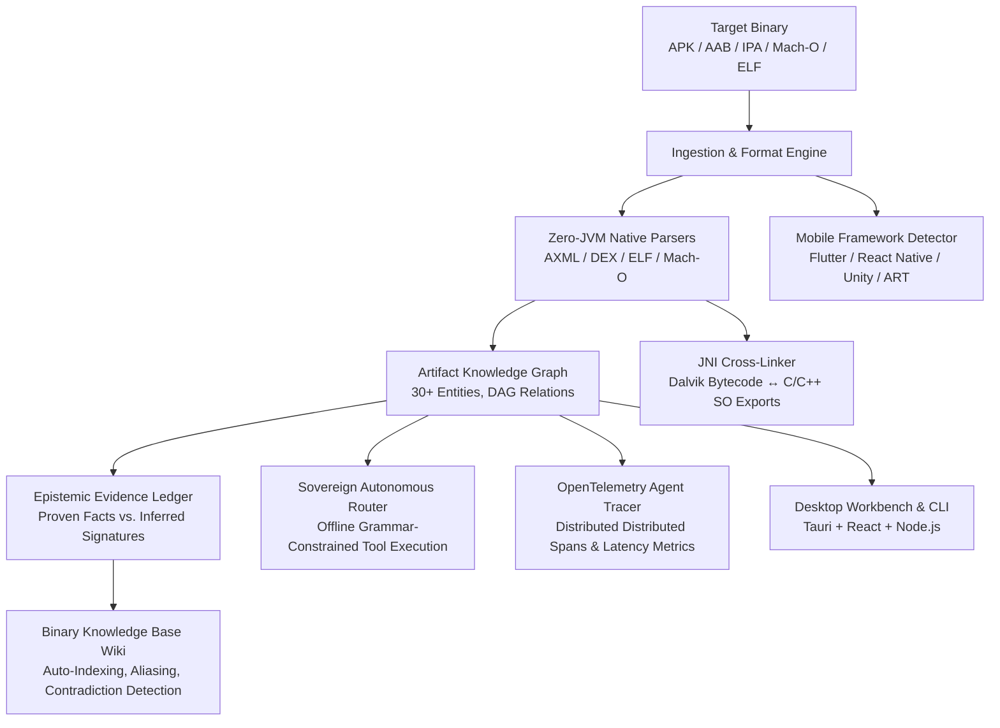

# OpenRev — Sovereign Software Intelligence & Reverse Engineering Platform

[](https://github.com/modelnorth/open-rev/actions/workflows/ci.yml)
[](LICENSE)
[](https://github.com/modelnorth/open-rev)
[](tests/)

**OpenRev** is an enterprise-grade, offline-first software intelligence and binary reverse-engineering platform. Engineered around generic software artifacts and capability-driven orchestration, it unifies deep mobile framework extraction, native Mach-O/iOS 18 analysis, cross-architecture JNI bridging, and autonomous grammar-constrained tool routing into a unified local workspace.

---

## Key Capabilities



### 1. Zero-JVM Native Binary Extraction
- **Pure Native Parsers**: Standalone DEX header, string pool, class definitions, and binary `AndroidManifest.xml` decoder running entirely without JVM or external Java runtimes.
- **ELF Dynamic Symbol Resolution**: Standalone 32-bit/64-bit ELF parser extracting DT_NEEDED libraries, machine targets, and exported JNI symbols without requiring Ghidra or IDA.

### 2. Deep Mobile Framework Extraction
- **Automatic Framework Detection**: Immediate identification of application runtime frameworks with high confidence:
  - **Flutter**: Detects `libflutter.so`, `libapp.so`, and asset bundles.
  - **React Native**: Detects Hermes bytecode (`index.android.bundle`), `libhermes.so`, and JavaScript runtimes.
  - **Unity**: Detects `libil2cpp.so`, `libunity.so`, and `global-metadata.dat`.
  - **Native ART / Kotlin / Java**: Detects Android runtime bytecode and multi-dex layouts.

### 3. JNI Bytecode-to-Native Cross-Linking
- Discovers Dalvik/ART `native` method declarations in DEX bytecode.
- Cross-references them directly against C/C++ exported symbols (`Java_com_example_...`) in architecture-specific shared objects (`armeabi-v7a`, `arm64-v8a`, `x86_64`).
- Automatically synthesizes `JniBridge` and `CALLS_NATIVE` / `LINKS` edges in the Knowledge Graph.

### 4. Epistemic Evidence Ledger
- Strict provenance tracking separating **Proven Facts** (deterministic byte-level extraction, confidence: 1.0) from **Inferred Hypotheses** (heuristics, rule matches, confidence: <1.0).
- Emits explicit scan boundaries, skipped regions, and mathematically verified coverage ratios for zero-hallucination compliance.

### 5. iOS 18 & Native Mach-O ARM64/ARM64e Parsing
- Complete 64-bit Mach-O parser decoding Mach headers, CPU subtypes (`ARM64`, `ARM64e`), load commands (`LC_LOAD_DYLIB`, `LC_RPATH`), and Objective-C / Swift symbol metadata from iOS IPAs.

### 6. Android Version Matrix Auditor (API 14 to API 36)
- Evaluates target APKs across 22 major Android API releases (Android 4.0 Ice Cream Sandwich up to Android 16).
- Flags deprecated APIs, exported component security risks, target SDK discrepancies, and permission permission model migrations.

### 7. Sovereign Autonomous Tool Routing Engine
- Ultra-fast, offline tool-calling and intent routing engine (`SovereignRouter`).
- Compiles OpenRev capabilities into BNF grammar constraints and JSON schemas for deterministic, local AI tool calling with zero data leakage to external clouds.

### 8. OpenTelemetry Agent Tracing & Binary Wiki
- **AgentOtelTracer**: Distributed tracing compatible with OpenTelemetry collectors, emitting spans, tool execution events, and latency breakdowns.
- **BinaryWikiEngine**: Auto-compiling Markdown knowledge base that catalogs discovered classes, components, and native exports, maintains de-obfuscation aliases, and flags cross-target contradictions.

---

## Architectural Comparison

| Dimension | OpenRev | Traditional RE Tools (JADX / Ghidra) | REA (`morluto/rea`) |
| :--- | :---: | :---: | :---: |
| **Runtime Dependencies** | **Zero JVM Required** (Pure Native TS/Rust) | Heavy Java / JVM runtime required | Node.js + external binaries |
| **Mobile Framework Detection** | **Built-in** (Flutter, Hermes, Unity, ART) | Manual inspection | Basic |
| **JNI Bytecode ↔ Native Cross-Link**| **Automated Graph Linking** | Manual symbol correlation | Partial |
| **Evidence Provenance** | **Epistemic Ledger** (Fact vs Inference) | Uncategorized output | Basic evidence tags |
| **iOS 18 / Mach-O Support** | **Built-in 64-bit ARM64/ARM64e** | Requires plugins | External tool delegation |
| **Android Version Coverage** | **API 14 through API 36** | Version-agnostic dump | Partial |
| **AI Tool Routing** | **Sovereign Grammar-Constrained** | None | Generic LLM prompting |
| **Distributed Observability** | **Native OpenTelemetry Spans** | None | None |
| **Knowledge Base Compiler** | **Self-Compiling Binary Wiki** | Static project files | Flat notes |
| **Integration Protocols** | **MCP + CLI + SDK + Tauri Desktop** | GUI / Batch CLI | CLI / MCP |

---

## Monorepo Layout

| Directory / Package | Description | Status |
| :--- | :--- | :---: |
| `packages/core` | Core platform engine, native parsers, knowledge graph, SQLite workspace, CLI | 🟢 Production |
| `packages/adapters` | External tool adapters (JADX, Apktool, ADB, Frida, Ghidra) with honest probing | 🟢 Production |
| `packages/providers` | Ingestion providers (`android`, `ios` Mach-O) | 🟢 Production |
| `packages/sdk` | High-level developer SDK (`@openrev/sdk`) | 🟢 Production |
| `packages/mcp-server` | Model Context Protocol server exposing capabilities over stdio | 🟢 Production |
| `packages/desktop` | Cross-platform Tauri / Rust desktop workbench | 🟢 Production |
| `packages/ui` | Dockable React + Vite desktop workspace frontend | 🟢 Production |
| `tests/` | Comprehensive test suite (unit, CLI, adapters, integration, MCP) | 🟢 73 Tests Passed |

---

## Getting Started

### Prerequisites
- **Node.js**: >= 22.5.0 LTS (utilizes native `node:sqlite`)
- **npm**: >= 10.0.0

```bash
# Clone the repository
git clone https://github.com/modelnorth/open-rev.git
cd open-rev

# Install all monorepo dependencies
npm install

# Run type checking across all workspaces
npm run typecheck

# Run complete automated test suite (73 tests)
npm test
```

---

## CLI Usage

OpenRev includes a command-line interface executable directly from source:

```bash
# Full static analysis of an APK (manifest, permissions, frameworks, JNI)
node --import tsx bin/openrev.js analyze tests/fixtures/FixtureApp.apk --json

# Query Knowledge Graph nodes and relationships
node --import tsx bin/openrev.js graph tests/fixtures/FixtureApp.apk --json

# Inverted-index keyword or regex search across artifacts
node --import tsx bin/openrev.js search tests/fixtures/FixtureApp.apk "INTERNET"

# Export executive Markdown intelligence report
node --import tsx bin/openrev.js report tests/fixtures/FixtureApp.apk --out report.md

# Probe system reverse engineering toolchains
node --import tsx bin/openrev.js deps --json

# Execute multi-stage automated audit workflow
node --import tsx bin/openrev.js workflow tests/fixtures/FixtureApp.apk --json
```

---

## Model Context Protocol (MCP) Integration

OpenRev acts as an MCP server, empowering AI agents with reverse engineering tools:

```json
{
  "mcpServers": {
    "openrev": {
      "command": "node",
      "args": ["--import", "tsx", "<path_to_openrev>/packages/mcp-server/src/index.ts"]
    }
  }
}
```

### Available MCP Tools:
- `analyze_target`: Full binary static analysis and knowledge graph compilation.
- `search_graph`: High-speed regex and keyword search over extracted artifacts.
- `query_graph_api`: Filter graph nodes by type (`Activity`, `JniBridge`, `Permission`) or exported status.
- `check_dependencies`: Real environment health checks for ADB, JADX, Apktool, Frida, Ghidra.
- `generate_report`: Formatted markdown intelligence reports.
- `run_workflow`: Executes automated DAG analysis workflows.

---

## Desktop Workbench

OpenRev features a lightweight, high-performance desktop workbench built on **Tauri** and **React**:

```bash
# Run web UI development server
npm run dev

# Build UI production assets
npm run build:ui

# Build standalone desktop application (requires Rust toolchain)
npm run build:desktop
```

Precompiled binaries for Linux (`.deb`/AppImage), macOS (`.dmg`), and Windows (`.msi`/`.exe`) are automatically built via GitHub Actions CI.

---

## Security & Verification

- **Zip Slip & Path Traversal Guard**: All archive extraction pipelines enforce strict canonical path boundary checks (`SecuritySanitizer`).
- **Secret & Supply Chain Hygiene**: Zero committed API tokens or sensitive credentials; all CI builds run automated secret audits and vulnerability gates.
- **Reproducible Verification**: Every test fixture and assertion runs offline with deterministic results.

---

## Contributing

Please see [CONTRIBUTING.md](CONTRIBUTING.md) and [ARCHITECTURE_FREEZE.md](ARCHITECTURE_FREEZE.md) before submitting pull requests.

## License

Licensed under the [Apache License, Version 2.0](LICENSE).
