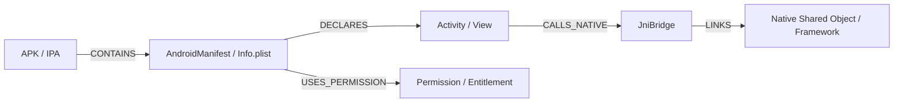

# OpenRev Artifact & Knowledge Graph Schema Reference

All artifacts in OpenRev are content-addressed via SHA-256 and stored immutably in SQLite workspaces.

---

## 1. Artifact Schema Types

| Artifact Type | Schema Version | Payload Description | Emitted By |
| :--- | :---: | :--- | :--- |
| `APK` | `v1.0.0` | Raw binary container attributes, size, package name | `AndroidProvider` |
| `Manifest` | `v1.0.0` | Decoded XML attributes, permissions, components | `ManifestExtractor` |
| `DEX` | `v1.0.0` | Dalvik header, string pool, class definitions | `DexHeaderParser` |
| `ELF` | `v1.0.0` | Dynamic symbol table, JNI exports, needed `.so` | `ElfHeaderParser` |
| `IPA` | `v1.0.0` | iOS package bundle metadata and Mach-O binary | `IosProvider` |
| `MachO` | `v1.0.0` | 64-bit ARM64/ARM64e load commands, dylibs | `MachOParser` |

---

## 2. Knowledge Graph Node Types

---

## 3. Epistemic Evidence Assertions

Assertions are tracked in `EpistemicLedger` with explicit confidence and modality:
- `proven`: Deterministically parsed from binary structures (Confidence: 1.0)
- `inferred`: Pattern-matched or heuristic signatures (Confidence: 0.0 - 0.99)
- `unobserved`: Declared but skipped or encrypted sections
